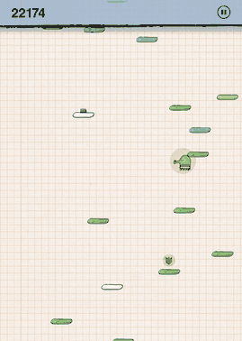
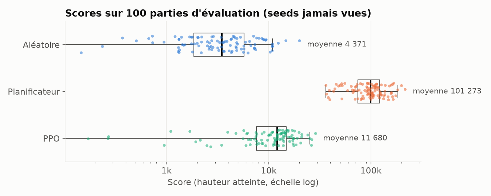
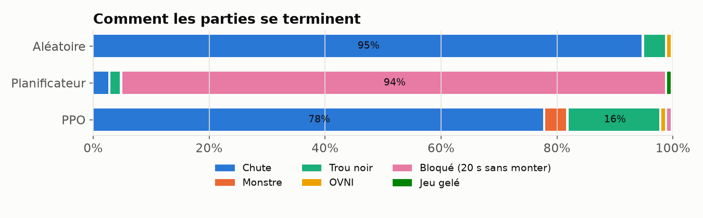
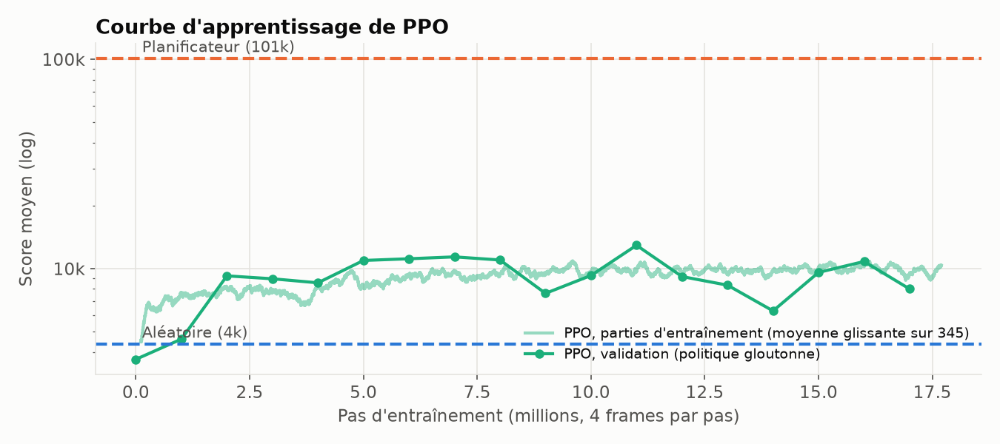
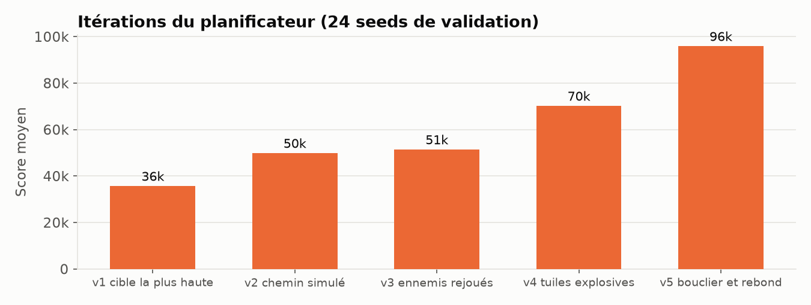

# DoodleJumpAgent

<p align="center"></p>

L'agent joue à un Doodle Jump écrit en Python que j'ai trouvé sur GitHub ([LunaTMT/Doodle-Jump](https://github.com/LunaTMT/Doodle-Jump)), sans toucher aux règles.
Je compare deux approches sur les mêmes 100 parties : un planificateur qui simule la physique exacte du jeu,
et un agent PPO (Stable-Baselines3) qui apprend sans connaître les règles.

> *EN: Agents for an existing third-party Python Doodle Jump, rules untouched. A planner that replays the game's
> exact physics scores 101k on average over 100 unseen seeds (23× a random agent); PPO, with or without imitation of
> the planner, plateaus around 12k (2.7× random). The write-up explains why.*

## Résultats

100 parties par agent, sur des seeds jamais utilisées pendant le développement ni l'entraînement
(`1 000 000 000` à `1 000 000 099`), plafond de 100 000 frames par partie.

| Agent | Moyenne | Médiane | Écart-type | Min | Max |
|---|---:|---:|---:|---:|---:|
| Aléatoire | 4 371 | 3 502 | 3 434 | 0 | 20 045 |
| PPO (depuis zéro, retenu) | 11 680 | 12 108 | 6 124 | 0 | 28 780 |
| PPO + imitation du planificateur | 10 545 | 11 857 | 6 296 | 0 | 26 011 |
| **Planificateur** | **101 273** | **99 696** | 37 568 | 36 366 | 216 378 |

Le score est celui du jeu : la hauteur maximale atteinte, en pixels.





Le planificateur ne meurt presque plus (5 parties sur 100). Il finit bloqué : 94 parties s'arrêtent
parce qu'aucune tuile n'est plus atteignable, la suivante étant plus haute qu'un saut (274 px). Ces culs-de-sac
viennent du jeu lui-même : les tuiles explosives sont retirées sans être décomptées, si bien que le jeu en
garde de moins en moins (6,9 tuiles perdues par partie en moyenne), et qu'à haut score la moitié des nouvelles
tuiles sont des pièges. PPO, lui, meurt : 78 % de chutes et 16 % de trous noirs. Il fait 2,7 fois mieux que
l'aléatoire, mais reste 9 fois sous le planificateur.

## La démarche

### 1. Analyser le jeu avant d'écrire un agent

Le rapport complet est dans [docs/01-analyse-du-jeu.md](docs/01-analyse-du-jeu.md). Ce que j'en ai retenu :

- La physique est en pas fixe, sans delta time : gravité 0,4 px/frame², saut à −15 (274 px), 5 px/frame
  à l'horizontale, et un écran qui reboucle à gauche et à droite. Le jeu est donc simulable exactement, et vite :
  ~15 000 frames/s sans rendu, contre 570 avec.
- Tout l'aléatoire passe par le module `random`, donc une seed suffit à rejouer une partie au bit près.
- Les hitboxes sont généreuses : toucher une tuile pendant la descente suffit pour rebondir, même par le côté.
  Toutes les tuiles font 57 × 15 px, quel que soit leur sprite.
- Plusieurs bugs du jeu définissent sa difficulté, et je les ai gardés tels quels. Les tuiles explosives sont
  retirées sans être décomptées, un palier de difficulté ne s'active jamais, et une tuile explosive se déclenche
  au moindre contact, même par le dessous.

### 2. Brancher un agent sans changer les règles

Je me suis limité à trois types de changements : un mode sans rendu, une API d'état et d'actions, et la gestion
de la seed. Ils sont regroupés dans [un fork du jeu](https://github.com/alexandreromanini/Doodle-Jump/tree/agent-api)
(sous-module `third_party/doodle-jump`, branche `agent-api`,
[4 commits](https://github.com/alexandreromanini/Doodle-Jump/compare/main...agent-api)) :

| Changement | Pourquoi |
|---|---|
| `Game.reset_game(seed)` / `Game.step(left, right, shoot)` | Jouer sans menus, frame par frame, avec des entrées injectées |
| La logique du ressort sort de `draw()` | Le ressort marquait son usage et déplaçait sa hitbox *pendant le dessin* : sans rendu, la partie changeait |
| `quadrant_idx` remis à zéro dans `reset_game` | Il passait d'une partie à l'autre, et deux parties avec la même seed différaient |
| `GameFrozen` au lieu d'une boucle infinie | Le placement des tuiles tire des positions sans limite. Si une zone est pleine, le jeu original gèle (≈ 0,3 % des parties aléatoires). Un test exhaustif, qui ne tire aucun nombre aléatoire, détecte ce cas exact |

J'ai vérifié que ces changements ne modifient pas le jeu.
[`tests/test_equivalence.py`](tests/test_equivalence.py) rejoue la même partie (même seed, mêmes entrées) dans le
jeu original avec rendu et dans le jeu modifié sans rendu, puis compare l'état complet à chaque frame : joueur,
tuiles, bonus, ennemis, balles. Les deux traces sont identiques. Le même test montre que l'original privé de rendu
diverge dès le premier ressort, ce qui justifie le deuxième changement.

L'environnement ([`src/doodle_agent/env.py`](src/doodle_agent/env.py)) suit l'API Gymnasium. Une partie se termine
à la mort, au gel du jeu, au plafond de frames, ou après 20 s sans gagner de hauteur.

### 3. Le planificateur

Comme le jeu est entièrement observable et déterministe, j'ai commencé par une référence qui exploite sa physique
exacte, contre laquelle je mesure ensuite l'approche apprise, PPO. J'ai aussi envisagé la neuroévolution, puis je
l'ai écartée : elle a le même signal d'apprentissage que PPO, avec des scores très bruités d'une seed à l'autre.

[`src/doodle_agent/planner.py`](src/doodle_agent/planner.py) recalcule son plan à chaque frame (*model predictive
control*). Son modèle reproduit l'arithmétique exacte du jeu : intégration d'Euler, caméra qui défile par pas
tronqués par `int()`, ordre des collisions, position horizontale sur un cercle de 129 positions. Des tests
vérifient qu'il prédit exactement la hauteur, le défilement et la frame du prochain rebond.

À chaque frame, il :

1. calcule chaque contact possible (tuile ou bonus, frame, plage de positions x) le long de la trajectoire prédite ;
2. garde les atterrissages les plus prometteurs, puis simule le chemin que suivra son contrôleur et regarde ce
   qu'il touche vraiment en premier ;
3. rejoue le code de déplacement des ennemis pour écarter les chemins mortels, y compris pendant la montée qui suit
   le rebond ;
4. pénalise le contact avec une tuile explosive (le jeu ne la remplacera jamais) et préfère les rebonds qui
   mènent plus haut.

J'ai fait évoluer chaque version en analysant les fins de partie, sur 24 seeds de validation distinctes des seeds
d'évaluation :



| Version | Ce qui a changé | Cause principale de fin avant ce changement |
|---|---|---|
| v1 | Vise la tuile la plus haute atteignable | (version de départ) |
| v2 | Juge un candidat sur ce que son chemin touche vraiment | Bloqué : une tuile intermédiaire interceptait toujours la descente |
| v3 | Rejoue le mouvement réel des ennemis, vérifie la montée après rebond | Trous noirs ; monstres extrapolés en ligne droite, d'où des chemins tous jugés mortels |
| v4 | Pénalise les tuiles explosives, exige un rebond qui progresse | Culs-de-sac créés par la perte de tuiles |
| v5 | Évite les ennemis même avec un bouclier, s'échappe à la frame du rebond | Bouclier dépensé sur un premier ennemi juste avant un second |

Une chose n'a pas marché : multiplier par 5 la pénalité sur les tuiles explosives. Le score est passé de 96 k à
93 k, dans le bruit, avec seulement 0,7 tuile perdue en moins par partie.

### 4. PPO

L'agent observe 248 valeurs : sa vitesse verticale, sa position x en sin/cos (l'écran reboucle) et l'état de ses
bonus ; les 12 tuiles les plus proches au-dessus et en dessous (dx avec repli, dy, type, vitesse, bonus, état) ;
et les 3 ennemis les plus proches (position relative, vitesse, type).

Il a 6 actions, {gauche, rien, droite} × {tir, pas de tir}, chacune répétée 4 frames. La récompense est la hauteur
gagnée divisée par 100, avec −1 à la mort : c'est exactement l'objectif, et rester sur place rapporte 0.

L'entraînement fait tourner 12 parties en parallèle (une par processus, le jeu n'en permet qu'une). Je valide sur
10 seeds dédiées et je sélectionne le meilleur modèle sur ces seeds uniquement.

J'ai essayé deux façons d'entraîner :

- Depuis zéro (17,5 M de pas, environ 1 h 30 sur 12 cœurs) : la validation passe de 3 700 à 9 000 en 2 M de pas,
  puis plafonne entre 6 000 et 13 000 (courbe ci-dessus). Le modèle retenu, le meilleur en validation (12 923), fait
  11 680 sur les seeds d'évaluation. Il est fourni dans [`models/ppo.zip`](models/ppo.zip).
- Imitation du planificateur, puis PPO : 4 tours de DAgger (le planificateur étiquette aussi les états où l'élève
  s'égare, soit 300 000 états), puis 10 M de pas de PPO avec des pas d'apprentissage plus petits. Résultat :
  10 545, pas mieux. Sa validation (12 170) était inférieure, donc ce n'est pas l'agent retenu.

L'imitation échoue parce que, sur des parties tenues à l'écart, le réseau retrouve l'action du planificateur
dans 44 à 46 % des cas, à peine plus que les 42 % obtenus en répondant toujours la direction majoritaire. Plus
d'entraînement le fait sur-apprendre. Le choix du planificateur (gauche ou droite, quelle cible, par quel bord de
l'écran) dépend de calculs exacts : la frame de chaque contact, ce qu'un chemin intercepte, le mouvement rejoué des
ennemis. L'observation ne permet pas de prévoir ces décisions sans refaire ces calculs.

Dans ce jeu entièrement observable et déterministe, connaître la physique vaut donc un facteur 9, même face à
17 M de pas d'apprentissage. PPO plafonne parce que son observation ne contient pas les quantités que le
planificateur calcule. La suite logique serait un hybride : donner à l'agent les atterrissages atteignables
calculés par le modèle physique.

### 5. Difficultés rencontrées

| Problème | Solution |
|---|---|
| Le jeu lit le clavier, ouvre une fenêtre et charge ses images dès l'import | Pilotes SDL factices, `reset_game`/`step`, une partie par processus |
| Ses chemins d'assets sont relatifs au répertoire courant (75 occurrences) | `chdir` au chargement ; les scripts résolvent leurs chemins avant |
| Logique de jeu cachée dans `draw()` | Déplacée dans `update()`, puis équivalence prouvée par le test de traces |
| L'entraînement PPO s'est figé après 70 000 pas | Un environnement bouclait dans le placement des tuiles. Chasse au bug avec 12 parties aléatoires et un chien de garde, puis `GameFrozen` |
| Planificateur trop lent (≈ 6 ms/frame) | Contacts de toute une frame en tableaux plats et un passage numpy par chemin. Décisions identiques vérifiées sur une partie complète |

## Installation

Python 3.12 (pygame 2.6.1 n'a pas de wheel pour 3.14).

```bash
git clone --recurse-submodules https://github.com/alexandreromanini/DoodleJumpAgent.git
cd DoodleJumpAgent
python3.12 -m venv .venv && source .venv/bin/activate
pip install -r requirements.txt --extra-index-url https://download.pytorch.org/whl/cpu
pip install -e . --no-deps
pytest                                   # 23 tests, ~20 s
```

## Utilisation

```bash
python scripts/play.py --agent planner --seed 1000000003      # regarder le planificateur jouer
python scripts/play.py --agent ppo --model models/ppo.zip           # l'agent PPO retenu
python scripts/evaluate.py --agent planner                     # 100 seeds d'évaluation, CSV dans results/
python scripts/train.py --out runs/ppo --seed 0                # PPO depuis zéro
python scripts/train.py --out runs/ppo_imitation --imitation   # imitation du planificateur, puis PPO
python scripts/record.py --agent planner --start 2400 --out assets/demo.gif
python scripts/plot.py --run runs/ppo                          # figures de ce README
```

Tous les hyperparamètres sont dans [`configs/default.toml`](configs/default.toml).

## Structure

```
configs/       hyperparamètres (planificateur, PPO, imitation, évaluation)
docs/          analyse détaillée du jeu
scripts/       train, evaluate, play, record, plot
src/doodle_agent/
  sim.py       chargement du jeu (headless ou fenêtré), constantes
  env.py       environnement Gymnasium
  planner.py   planificateur à modèle exact
  imitation.py imitation du planificateur (DAgger)
  agents.py    interface commune aux agents
tests/         environnement, modèle du planificateur, équivalence avec le jeu original
third_party/doodle-jump   le jeu (sous-module, fork avec les 4 changements)
models/        modèle PPO retenu
results/       CSV d'évaluation et figures
```

## Pistes d'amélioration

- Le jeu permet de glisser une fois certaines tuiles à la souris. Le planificateur pourrait s'en servir pour
  franchir une bonne partie des culs-de-sac, au prix d'une action souris dans l'API (et d'une comparaison PPO à
  refaire avec le même espace d'actions).
- Retomber sur un monstre ou un OVNI le tue et fait rebondir : les monstres pourraient servir de marches.
- PPO pourrait recevoir une observation plus riche, par exemple une grille de l'écran, ou les fenêtres
  d'atterrissage atteignables calculées par le modèle physique. Ce dernier cas devient un hybride planificateur
  et apprentissage.
- L'évaluation tournerait plus vite avec le modèle du planificateur porté en numba ou en Rust.

## Crédits

Le jeu est [LunaTMT/Doodle-Jump](https://github.com/LunaTMT/Doodle-Jump), utilisé comme sous-module via
[un fork](https://github.com/alexandreromanini/Doodle-Jump/tree/agent-api) qui ajoute les 4 changements décrits plus haut. Ses images et
sons viennent du Doodle Jump original de Lima Sky.
